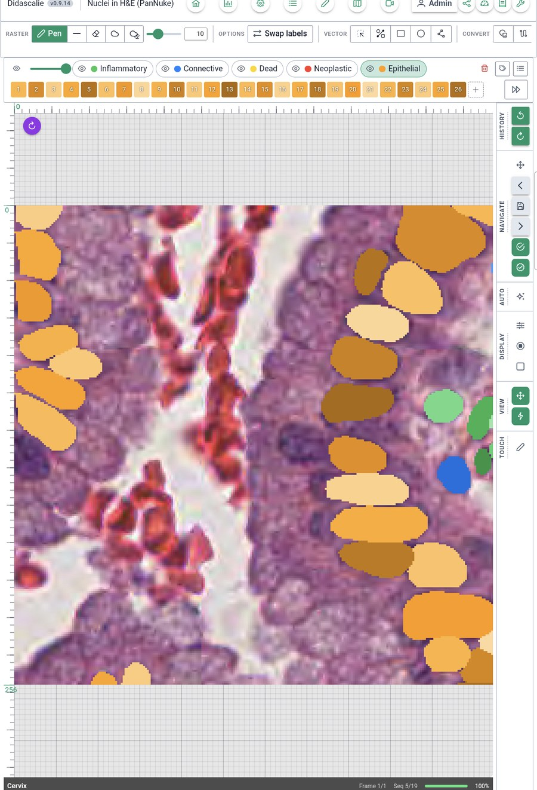

# Android tablets

Didascalie runs on Android tablets, with finger and pen input. This is recent:
it works, but it has been tested on one device, a Samsung Galaxy Tab S9 FE with
Android 16.

{ width="420" }

## What works

- Opening a `.dida` file from the tablet's storage, or with **Open with** from a
  file manager or a mail attachment.
- The gallery and the editor, with the raster and vector tools.
- Registration and the 3D projection view take touch input, but have been
  tried less than the editor.
- Touch: one finger draws, two fingers pan and pinch, a long press opens the
  label picker.
- Portrait and landscape. In portrait the labels move to a bar above the
  canvas.

## What is missing

| Not on Android | Why |
| --- | --- |
| Trained model, MedSAM | The training and inference stack is not built for Android. |
| Projects made from video files | Frames are decoded by `ffmpeg`, which Android does not have. |
| Importing microscopy files | They are converted by a separate desktop program. |
| [Python functions](guide/python-functions.md) | ZeroMQ is left out of the build. |
| Creating a project, importing, exporting to COCO or YOLO | They rely on desktop folder dialogs. Prepare the project on a computer. |
| Detached windows, automatic updates | Desktop only. |

## Projects on the tablet

Android hands an application a picked file as a stream, not as a path a database
can open. Didascalie therefore copies the project into its own storage and works
on that copy:

- Opening a large project takes the time of the copy, and the tablet holds the
  file twice. The original can be deleted afterwards.
- Annotations are not written back to the file you opened. To get them out, use
  **Save a copy** (the share icon in the top bar), which writes the project with
  its annotations wherever you choose.
- Projects already opened stay under **Recent**, and survive an update of the
  application. Uninstalling it deletes them.

!!! tip "The file does not show in the picker"
    Samsung's file picker has filter chips (Image, Video, Document…). With one
    selected, `.dida` files are hidden. Tap the highlighted chip to clear it.

## Tablet controls

- **Frames.** On a sequence, a strip with previous and next buttons and a slider
  runs under the canvas, or down its left edge when the tablet is upright.
- **Touch & pen** options, opened from the **Touch** button of the tool rail:
    - pressure sensitivity: pressing harder draws a wider stroke;
    - draw with the pen only: a finger then pans the image;
    - pen side button: a stroke with the button held erases, pans or opens the
      label picker. Hold the button before the pen touches the screen.

## Installing the APK

Each [release](https://github.com/ClementPla/Didascalie/releases/latest) has an
APK for 64-bit ARM tablets, which covers recent ones:
`Didascalie_<version>_android_arm64.apk`.

1. Download it on the tablet, or copy it there.
2. Open it from the file manager or the browser's downloads. Android asks to
   allow installing apps from that source: allow it, then install.

The application does not update itself on Android. To update, install the APK
of the new release over the old one: the projects on the tablet are kept. An
app such as [Obtainium](https://github.com/ImranR98/Obtainium) can watch the
releases and install new versions for you.

## Building from source

### Requirements

What a desktop build needs (see [Installing](install.md#building-from-source)),
plus:

- Android Studio, with the SDK, its build tools and the NDK (**SDK Manager** →
  **SDK Tools**);
- a JDK 17;
- the Android Rust target: `rustup target add aarch64-linux-android`.

Three environment variables must be set:

| Variable | Points to |
| --- | --- |
| `ANDROID_HOME` | the SDK folder |
| `NDK_HOME` | one version folder under `$ANDROID_HOME/ndk/` |
| `JAVA_HOME` | the JDK 17 |

### Build

From the repository:

```bash
npm install
npx tauri android build --apk --target aarch64
```

The first build takes a while. The result is an unsigned APK:
`src-tauri/gen/android/app/build/outputs/apk/universal/release/app-universal-release-unsigned.apk`.

### Sign

Android only installs signed APKs. An APK you build yourself cannot update one
installed from a release, which is signed with another key: uninstall that one
first.

Create a key once:

```bash
keytool -genkeypair -keystore my-key.jks -alias didascalie -keyalg RSA -keysize 2048 -validity 10000
```

Then align and sign the APK. `zipalign` and `apksigner` are in
`$ANDROID_HOME/build-tools/<version>/`:

```bash
zipalign -f -p 4 app-universal-release-unsigned.apk didascalie.apk
apksigner sign --ks my-key.jks didascalie.apk
```

Keep the key: an update must be signed with the same one, or Android refuses it
until the application is uninstalled, which deletes the projects stored on the
tablet.

To have the build sign the APK itself, write the key's details in
`src-tauri/gen/android/keystore.properties`, which git ignores:

```properties
storeFile=/path/to/my-key.jks
storePassword=...
keyAlias=didascalie
keyPassword=...
```

The build then produces `app-universal-release.apk`, already signed.

### Install

On the tablet, turn on the developer options (**Settings** → **About tablet** →
**Software information**, tap **Build number** seven times), then **USB
debugging** in **Developer options**. Plug the tablet in and accept the prompt
it shows.

```bash
adb devices
adb install -r didascalie.apk
```

`adb` is in `$ANDROID_HOME/platform-tools/`. `-r` replaces an installed version
and keeps its projects. Without a cable, copy the APK to the tablet and open it
from a file manager; Android asks to allow installing from that source.

To update, pull the repository and repeat the build, sign and install steps.
