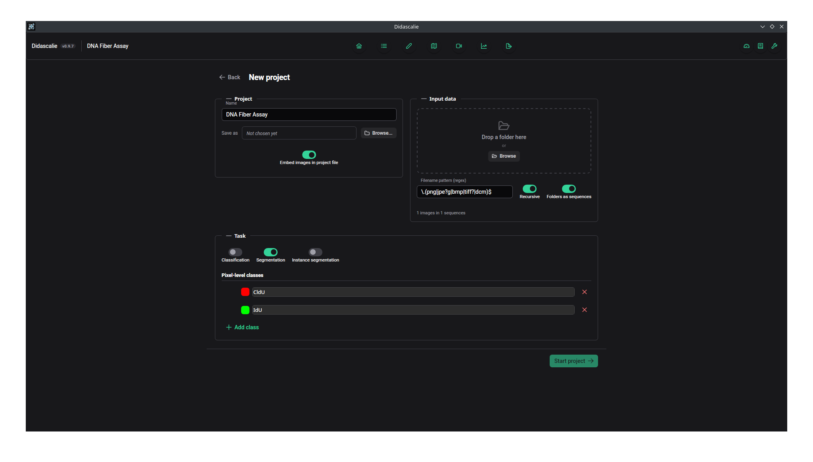

# Quickstart

One project, from creation to export: create it, annotate an image, train a
model on a few scribbles, and get the data out.

## 1. Create a project

Launch Didascalie and choose **New project**. You will be asked for:

- a **name** and where to save the `.dida` file;
- an **input folder** of images, videos or microscopy files, and which
  formats to take from it (all of them by default; see
  [Supported files](guide/projects.md#supported-files));
- whether to **embed** the images or reference them on disk
  ([which to pick](guide/projects.md#embedded-or-referenced-images));
- which **annotation types** the project uses: segmentation, classification, text;
- **your name**, for the project's first account. You can leave it empty if you
  work alone.

Other people can later add their own account to the same project and annotate
it independently. See [Several annotators](guide/multi-user.md).



## 2. Annotate a frame

The gallery opens on the imported images. Double-click one to open the editor.

Pick the pen (++p++) and draw. Switch labels with ++ctrl+tab++. ++ctrl+z++ undoes
both mask and vector edits.

You do not have to follow the boundary precisely. Draw roughly, then apply an
operator to tidy it up, as described in
[Assisted labelling](guide/assistance.md#operators-bounded-by-your-stroke).

<!-- SCREENSHOT: the editor with a mask drawn over an image. -->

## 3. Mark it reviewed

When a frame is finished, mark it **reviewed**. Model training only uses reviewed
frames, so a frame you have not marked is ignored in the next step.

## 4. Train on a few scribbles

Once you have a few reviewed frames (at least two), open **Segmentation head
lab** from the top bar and click **Train model**. The built-in features need no
download; a pretrained encoder can be downloaded from the same page for better
results.

Back in the editor, the **Model** button predicts the open frame. Correct the
prediction, mark the frame reviewed, and train again. Details are in
[Assisted labelling](guide/assistance.md#training-a-model-on-your-own-data).

## 5. Get the data out

Export from the app (see [Import and export](guide/import-export.md)) or read the
project directly from Python:

```python
from didascalie import DidascalieProject

with DidascalieProject("dataset.dida") as project:
    for sequence, frame in project.iter_frames():
        for label, mask in project.get_annotations_for_frame(frame.id):
            ...  # mask: a NumPy array the size of the frame
```

See [Python library](python.md).
