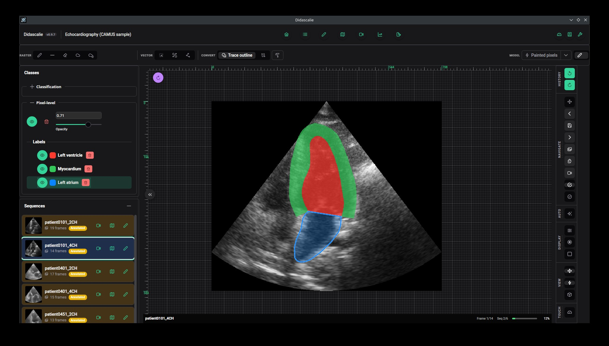
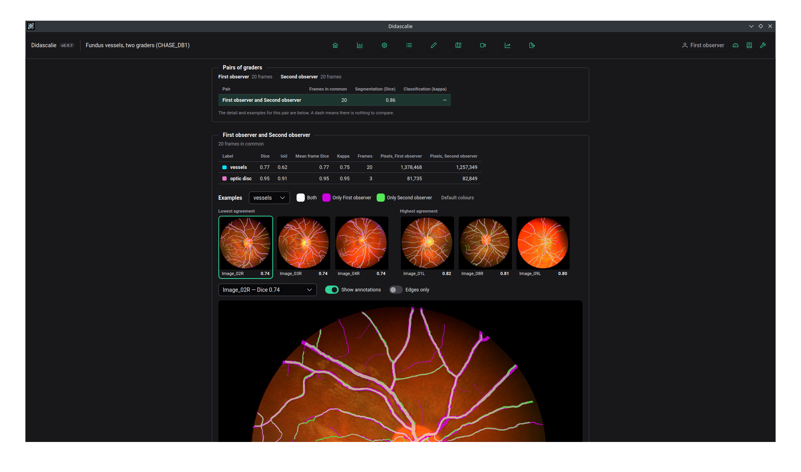

# Summary

Didascalie is a desktop application for annotating biomedical images, covering a range of tasks from segmentation, registration to classification, and including the ability to compare
the people or models that labelled them. Didascalie runs entirely on the user’s device and never communicates with the outside world, so no image ever leaves it. It ships as a single executable for desktop and mobile platforms alike, and each project is stored in one self-contained file. A researcher or clinician simply installs it, opens the project and starts annotating, with no server to set up and no programming environment to maintain.

The same editor and tools handle 2D images, videos and 3D volumes. Structures can be outlined with a brush, a lasso or vector shapes, and a rough stroke can be automatically snapped to the boundary of the underlying structure (\autoref{fig:editor}). Beyond segmentation, frames can be classified, annotated with keypoints and registered to one another. Several annotators can work on the same project, each under their own account, and the application quantifies their agreement. Didascalie runs on Windows, macOS and Linux, and an Android build brings touchscreen annotation to tablets.


# Statement of need

Supervised models in biomedical imaging depend on labels drawn by people with domain knowledge, such as clinicians, pathologists, biologists. Three constraints shape the
software these people can use.

First, the images often cannot be sent to a hosted service, because institutional data-governance and ethics rules often prohibit it. Second, annotators are rarely engineers:
asking a clinician to deploy a container or maintain a Python environment is a real barrier, and in the author's experience many still annotate in presentation or drawing software. Finally, a single study commonly mixes data types and tasks, such as multimodal images, gigapixel microscopy, videos and volumes, to be segmented, classified or registered.

Didascalie is designed for this situation. It ships as a single installed application, each project is one portable file, and all processing runs on the annotator’s own hardware, so there is no upload path to audit. Annotators also learn a single tool whatever the data. A video is treated as a sequence of frames and a volume as a sequence of slices, and both open in the same editor as single images, where the brush, lasso, assisted contouring, display adjustments and undo history all behave identically. Ease of use has guided the design throughout, and the interface was developed with clinicians who annotate without an engineering background.

Projects can also be shared between people. Each annotator has their own account within the project file and labels the same images without seeing anyone else’s work, as a reader study or a double-graded dataset requires. An agreement page then compares graders pairwise: Dice, IoU and Cohen’s kappa for each label; percent agreement and kappa for each classification task; and the frames on which two graders disagree most (\autoref{fig:agreement}). 



The same mechanism can be used to evaluate models. The companion library `pydidascalie` writes a model’s predictions under a dedicated account, alongside the annotators’ work rather than over it, so that several models, or a model and the reference annotations, can be compared exactly like two graders.

# State of the field

CVAT [@cvat] and Label Studio [@labelstudio] are capable, actively maintained annotation platforms, but both are web applications. Running either locally means operating a server: a Docker Compose stack for CVAT, a Python package served to a browser for Label Studio. This is a modest task for an engineer but an obstacle for a clinician working on a hospital workstation.

Among desktop tools, ilastik [@berg2019ilastik] and LABKIT [@arzt2022labkit] focus on interactive segmentation. The user scribbles on a few regions to train a pixel classifier, whose output, optionally corrected, becomes the segmentation. Neither tracks review status, records image-level classification labels or compares annotators. napari [@napari] is a general n-dimensional viewer with annotation layers and a standalone installer, but it leaves dataset-level curation to plugins or scripts. QuPath [@bankhead2017qupath] is specialised for digital pathology. 3D Slicer [@fedorov2012slicer] is a general clinical image-computing platform whose segmentation tools operate on one volume at a time, without dataset-level review or multi-annotator tracking. Desktop labelling tools descended from LabelMe [@Russell2008LabelMe], notably X-AnyLabeling [@X-AnyLabeling], come closest to offline dataset curation and include local inference with lightweight Segment Anything variants [@kirillov2023sam]. They target general computer-vision formats and tasks, however, and neither track review status nor compare annotators. Finally, model-assisted labelling in clinical viewers, as provided by MONAI Label [@diazpinto2024monailabel], relies on a separate inference server.

Didascalie was built as a new tool rather than an extension of an existing one because its requirements are architectural rather than feature-level. A plugin for napari or 3D Slicer inherits its host’s interface, a general-purpose viewer that exposes far more than an annotation task needs. It also inherits the host’s distribution model: a Python runtime and a plugin system that the annotator must keep working across updates. That same dependency rules out tablets, on which none of these desktop tools run. Extending a LabelMe-style tool such as X-AnyLabeling avoids the first problem but not the second, and its one-annotation-file-per-image storage conflicts with Didascalie’s design. Didascalie stores a whole project, including per-annotator accounts, in a single file, and runs natively on Android tablets as well as desktop systems. Raster and vector annotations share one document and one undo history, and the editor stays responsive on gigapixel images. Adding these properties to any of the platforms above would mean replacing its storage, rendering and distribution layers, which amounts to writing a new application inside an existing one.

# Software design

## Project format

Each Didascalie project is a single SQLite database. It holds the annotations, the label definitions and the annotator accounts, and it either embeds the images or references them on disk. Referenced paths are resolved separately on each machine, so the same project opens on Windows, macOS, Linux and Android. Sharing a task with a collaborator therefore amounts to sending one file. Because SQLite can be read from almost any programming language, projects remain accessible outside the application, and the `pydidascalie` package reads and writes them from Python without Didascalie running.

## Architecture

The application is built with Tauri. A Rust core handles image decoding, mask encoding and database access, while a web frontend, rendered in the platform’s native webview, provides an interface that is identical across platforms. Performing the heavy work in compiled code rather than in JavaScript or an interpreted language keeps editing responsive on large images, including on tablets. Masks are composited on the GPU through WebGPU, with a CPU fallback where WebGPU is unavailable.

Images too large for a webview to decode are stored as a resolution pyramid. The viewer draws the coarsest level that still provides at least one image pixel per screen pixel, and loads full-resolution tiles only for the region being inspected. Editing always takes place at the image’s native resolution.

Microscopy and whole-slide formats are read through bioformats-rs [@henriksson2026staticanalysisguidedagenticai], a Rust port of the original Bio-Formats library [@10.1083/jcb.201004104], which gives Didsacalie direct access to most of the common microscopy files without a Java runtime.

## Annotation assistance

Rather than tracing a structure’s outline, the annotator can paint a rough stroke over it, and an operator decides which pixels under the stroke belong to the structure. Three operators are available: Otsu thresholding computed within the stroke, flood fill, and superpixel selection. Their output can be smoothed, have holes filled, or be restricted to a single connected region. Contrast, gamma and tone-curve adjustments are applied before the operator runs, so it works on the same enhanced image the annotator sees.

These operators are the default because they run immediately on a CPU and need no training data. Their behaviour is also predictable: when one gives a poor result, the annotator can usually see why and correct it by hand. A learned alternative is in development. It trains a small classifier on the annotator’s scribbles using features from a frozen self-supervised encoder [@amir2021deepvit; @oquab2024dinov2; @simeoni2025dinov3]. Whether it outperforms the classical operators has not yet been evaluated.

## Registration

Registration between two images is done by placing pairs of keypoints; Didascalie re-estimates a homography after each new point.
Overlay and checkerboard views show the current alignment as points are added.

## Running user models
Importing models directly into the application would require a common exchange format such as ONNX, and research architectures often fail to export to one. Didascalie instead connects locally to a Python process run by the user (optionnally). The user writes a function that takes the image as an array and returns one mask per label, adds a decorator, and runs the script:

```python
from didascalie.com import register_seg, serve

@register_seg
def vessels(image):
    return {"vessels": my_model(image) > 0.5}

serve()
```

The function then appears in the editor, where it can be run on the current frame or on the whole sequence. A second decorator registers functions that propose keypoint correspondences for registration. Beyond its input and output types, Didascalie places no constraints on what the function does, and it runs in the user’s own Python environment.

This function is not available on mobile device.
# Research impact statement

Didascalie has been used in several clinical and laboratory settings since 2024,
first under the name LabelMed.

- The training annotations of DNAi, a tool for DNA fibre analysis, were produced
  with it [@playout2026dnai].
- It was used to annotate retinal neovascularisation in high-resolution
  ultra-widefield fundus images, a task that relies on full-resolution editing of
  large images and required to register angiography with regular fundus.
- It was used to create the optic disc and macula annotations behind the models of
  the fundus-odmac-toolkit [@odmac_toolkit].
- Several studies in preparation rely on it for their annotations, mostly in
  ophthalmology, which requires multimodal imaging and high-resolution editing.

Source and installers are available at <https://github.com/ClementPla/Didascalie> under the BSD-3-Clause licence, with
user documentation at <https://didascalie.readthedocs.io>.

# AI usage disclosure

Development began in 2024, without generative AI.
Since 2026, Claude Code (Anthropic), with the Claude Sonnet and Opus models available at the time, up to Claude Opus 5.5, has been used to implement features, write tests, fix defects and draft the documentation, from requirements and design decisions set by the author. It also assisted in revising the language of the manuscript. The author reviewed the generated code and text, and edited or rejected them where needed.
In addiition, generated code was validated by the unit tests and continuous integration of the repository, and by use of the application on real data, by the author and by the
clinicians who annotate with it. The author takes responsibility for all of the software and of this paper.

# Acknowledgements

The author thanks the clinicians and researchers from Maisonneuve-Rosemont Hospital
and Polytechnique Montréal whose sustained feedback shaped the annotation workflow,
as well as the Line-Chevrette funding (FRTIAO) that supported the development of the
application.

# References
